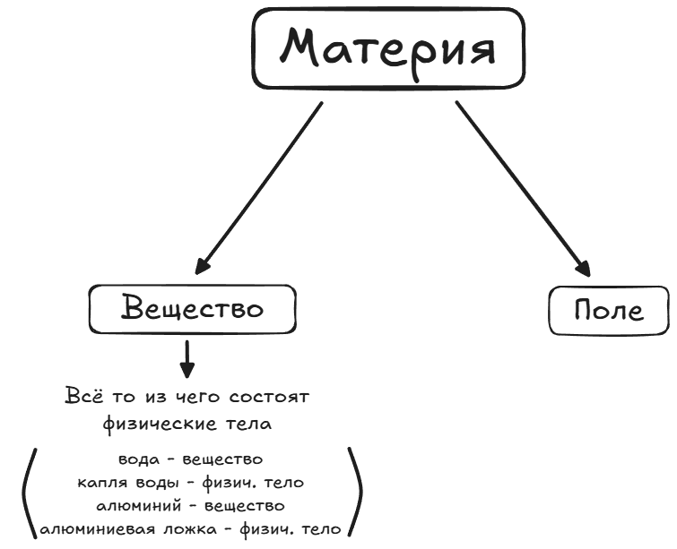
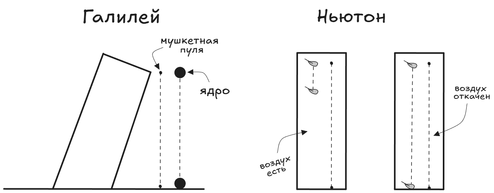

# Наука о природе

Физика (от греч. physis — природа) — это наука, изучающая физические явления в неживой природе.

Каждое из окружающих нас тел называют физическим телом, или телом (песчинка, камень, Луна).

Всё, что нас окружает, — это Вселенная, а всё то, что существует в ней независимо от нашего сознания, — материя.

В физике изучают механические, электромагнитные, тепловые, звуковые и световые явления. Все эти явления — физические.

---

## Наблюдения и опыты

Наблюдение — это сбор информации с помощью органов чувств в окружающей действительности.
Закономерности устанавливаются при сборе большого количества данных о явлении или предмете изучения. Получая новую информацию, мозг сопоставляет её с имеющимися данными и делает умозаключения — гипотезу.
Опыт — специально спроектированная ситуация для установления верности или ложности гипотезы. То есть опыт проводится по запланированному плану с определённой целью.

Например:

Наблюдение - тяжёлые тела (книга) падают быстрее лёгких (лист бумаги).

Гипотеза - любое тяжёлое тело падает быстрее лёгкого.

Эксперимент - комок бумаги падает быстрее несвёрнутого листа (их масса одинакова).

Гипотеза - что-то влияет на скорость падения бумаги (воздух?).

Эксперимент - изученим падения уменьшенных или исключённых влияний воздуха.

Закон - все тела падают под действием силы тяжести одинаково (свободного падения).

