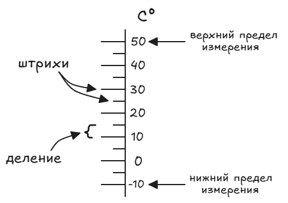

# Физические величины и их измерения

Физическая величина — это физическое понятие, выраженное числом в процессе измерения (длина, масса, время, скорость и т. д.).

Измерение физической величины — сравнение её с однородной величиной, принятой за единицу.

| ⁣‍⁣​‌‌​‌‌​‌​‌‌​‌‌​‌​‌‌‌​‌‌‌​​‌‌​​‌​​‌‌​‌​​​​‌‌​​​‌‌​‌‌‌​​‌‌​‌‌​‌‌​​​‌‌​​‌​‌​​‌‌​​‌‌​​‌‌​​‌‌​‌‌​‌‌​​​​‌‌‌​​​​‌‌​‌​​​​‌‌‌​​​​⁣‌⁣Величина | Единицы измерения                                                |
| -------------------------------------------------------------------------------------------------------------------------------------- | ---------------------------------------------------------------- |
| Длина                                                                                                                                  | Миллиметр, сантиметр, метр, километр, миля, дюйм, верста         |
| Время                                                                                                                                  | Секунда, минута, час, сутки, неделя, месяц, год                  |
| Масса                                                                                                                                  | Миллиграмм, грамм, килограмм, центнер, тонна, фунт, карат, унция |

В СИ (система интернациональная) основные единицы измерения:

- метр (длина);
    
- секунда (время);
    
- килограмм (масса);
    
- ампер (сила тока);
    
- кельвин (температура);
    
- моль (количество вещества);
    
- кандела (сила света).

Часто применяют единицы, которые в 10, 100, 1000… раз больше принятых единиц (кратные). Они получили названия с соответствующими приставками (из греческого языка): дека — 10, гекто — 100, кило — 1000 и др.
А если применяют единицы, которые в 10, 100, 1000… раз меньше принятых единиц (дольные), то используют приставки (из латинского языка): деци — 0,1, санти — 0,01, милли — 0,001 и др.

| ⁣‍⁣​‌‌​‌‌​‌​‌‌​‌‌​‌​‌‌‌​‌‌‌​​‌‌​​‌​​‌‌​‌​​​​‌‌​​‌​​​‌‌‌​‌​​​‌‌‌‌​‌​​​‌‌​‌‌​​‌‌​​‌​‌​​‌‌​‌‌​​‌‌‌​​‌‌​‌‌‌​​‌‌​‌‌​‌‌‌‌​‌‌‌‌​​​⁣‌⁣ | Приставка | Множитель | Обозачение |
| :---: | --------- | --------- | ---------- |
|  Кратные                                                                                                                    | дека      | ×10       | да         |
|                                                                                                                                | гекто     | ×100      | г          |
|                                                                                                                                | кило      | ×1000     | к          |
|  Дольные                                                                                                                 | деци      | ×0,1      | д          |
|                                                                                                                                | санти     | ×0,01     | с          |
|                                                                                                                                | милли     | ×0,001    | м          |

---

## Цена деления шкалы измерительного прибора

Измерительные приборы имеют шкалу, т.е. на них нанесены штриховые деления, а рядом написаны значения величин, соответствующие делениям. Изобразим шкалу термометра:

Цена деления шкалы — это расстояние между ближайшими штрихами шкалы, выраженное в единицах измеряемой величины.

C — цена деления.

Чтобы определить цену деления, нужно:
- найти два ближайших штриха шкалы, возле которых написаны значения величины;
- вычесть из больших значений меньшее и полученное число разделить на число делений, находящихся между ними.

Например, определим цену деления нашего термометра:

Возьмём 2 штриха 30° и 20°. Расстояния между ними разделены на 2 деления. Значит:

$с=\frac{30\degreeС-20\degreeС}{2}=5\degreeС$
Т. о. цена каждого деления = 5°C.

